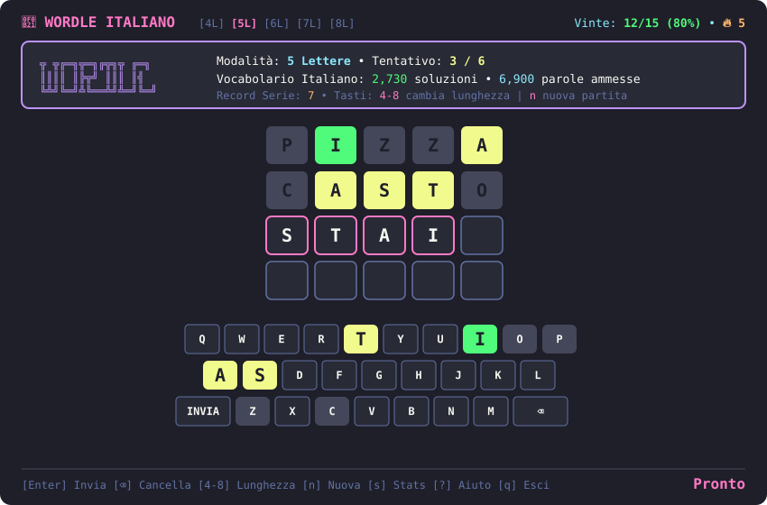

# 󰬡 Wordle TUI (Italiano)

[](https://www.python.org/)
[](https://textual.textualize.io/)
[](https://draculatheme.com/)
[](LICENSE)

Un moderno gioco **Wordle in lingua italiana** per il terminale, con interfaccia grafica basata su **Textual**, estetica **Dracula**, supporto alla **lunghezza variabile delle parole** (da 4 a 8 lettere), vocabolario completo offline e integrazione per **Waybar**.



---

## ✨ Funzionalità Principali

- 📏 **Lunghezza Parole Configurabile**: Gioca non solo con le classiche 5 lettere, ma anche con parole da **4, 5, 6, 7 e 8 lettere**!
- 📚 **Dizionario Italiano Completo & Offline**:
  - Più di **80.000 parole italiane** ottimizzate e compresse localmente (~600 KB).
  - Doppia lista: **soluzioni segrete riconoscibili** (dal vocabolario comune) e **parole ammesse** (dal dizionario esteso con coniugazioni e forme flesse per una validazione accurata dei tentativi).
  - Nessuna dipendenza da API esterne: avvio istantaneo e funzionamento 100% offline.
- 🎨 **Estetica Dracula Completa**:
  - Palette colori ufficiale: Sfondo `#1e1f29`, Carte `#282a36`, Bordi viola `#bd93f9`, Verde `#50fa7b`, Giallo `#f1fa8c`.
  - Caselle reattive con stati di battitura, lettere esatte, errata posizione e assenti.
  - Tastiera virtuale a schermo con aggiornamento cromatico in tempo reale delle lettere giocate.
- 📋 **Condivisione Risultati**: Generazione e copia con un click della griglia emoji (es. `🟩🟨⬛⬛🟩`) compatibile con Wayland (`wl-copy`).
- 📊 **Statistiche Dettagliate & Persistenti**:
  - Tracciamento vittorie, percentuali, serie attuale 🔥 e serie record 🏆.
  - Distribuzione grafica dei tentativi e storico suddiviso per lunghezza di parola.
- 🐧 **Desktop & Waybar Ready**: Subcomando `waybar` per visualizzare statistiche e serie direttamente sulla barra di stato di Hyprland/Sway.

---

## 🕹️ Comandi & Scorciatoie da Tastiera

### Durante la Partita
| Tasto | Azione |
| :--- | :--- |
| `A` - `Z` | Digita una lettera (nessun conflitto con le scorciatoie) |
| `Enter` | Invia il tentativo (con validazione del vocabolario) |
| `Backspace` / `⌫` | Cancella l'ultima lettera digitata |
| `Ctrl+A` | Arrenditi istantaneamente e svela la parola segreta |
| `Esc` | Apri il **Menu Opzioni / Pausa** |

### Nei Menu e Finestre di Dialogo
| Tasto | Azione |
| :--- | :--- |
| `↑` `↓` `←` `→` | Naviga tra i pulsanti |
| `Tab` / `Shift+Tab` | Scorre i pulsanti in avanti / indietro |
| `Enter` / `Spazio` | Attiva il pulsante selezionato (evidenziato in rosa Dracula) |
| `N` | Nuova partita |
| `A` | Arrenditi e rivela la parola |
| `L` / `4` - `8` | Cambia lunghezza parola (4, 5, 6, 7 o 8 lettere) |
| `S` | Statistiche e distribuzione dei tentativi |
| `C` / `Y` | Copia griglia emoji negli appunti (`wl-copy`) |
| `Q` / `Esc` | Chiudi dialog / Torna al gioco / Esci |

---

## 📦 Installazione

### Requisiti
- Python `>= 3.10`
- Terminale con supporto TrueColor (es. `kitty`, `alacritty`, `foot`)
- `wl-clipboard` (opzionale, per copiare le emoji negli appunti su Wayland)

### Installazione da Repository

```bash
git clone https://github.com/LucaPezzato/wordle-tui.git
cd wordle-tui
pip install -e .
```

---

## 🚀 Utilizzo

### Avvio Gioco
```bash
# Avvia Wordle classico (5 lettere)
wordle-tui

# Avvia con lunghezza personalizzata (es. 6 lettere)
wordle-tui --length 6

# Visualizza statistiche nel terminale
wordle-tui stats

# Aggiorna il vocabolario italiano dall'upstream
wordle-tui update-dict
```

---

## 📊 Integrazione Waybar (Hyprland / Sway)

`wordle-tui` espone il subcomando `wordle-tui waybar` che restituisce un payload JSON conforme:

```json
{
  "text": "󰬡 80% 🔥5",
  "tooltip": "Wordle TUI - Italiano\nPartite giocate: 15\nVittorie: 12 (80%)\nSerie attuale: 🔥 5 (Max: 7)\nUltima: 5L (Vinta in 3 tentativi)",
  "class": "won"
}
```

### Configurazione `~/.config/waybar/config.jsonc`

```jsonc
"custom/wordle": {
    "exec": "wordle-tui waybar",
    "return-type": "json",
    "interval": 10,
    "on-click": "kitty --class wordle-tui wordle-tui",
    "signal": 12
}
```

### Stile CSS `~/.config/waybar/style.css`

```css
#custom-wordle {
    background-color: #282a36;
    color: #f8f8f2;
    border-radius: 8px;
    padding: 0 10px;
    margin: 3px 4px;
    border-bottom: 2px solid #bd93f9;
}

#custom-wordle.won {
    color: #50fa7b;
    border-bottom: 2px solid #50fa7b;
}

#custom-wordle.played {
    color: #f1fa8c;
}
```

---

## 🖥️ Desktop & Window Manager Integration

### Desktop Entry

```bash
cp wordle-tui.desktop ~/.local/share/applications/
```

### Regola Finestra Fluttuante per Hyprland

Se utilizzi **Hyprland**, puoi aggiungere al tuo file di configurazione (`hyprland.conf` o `hyprland.lua`) la seguente regola per aprire il gioco come popup centrato e fluttuante:

```conf
# hyprland.conf
windowrulev2 = float, class:^(wordle-tui)$
windowrulev2 = size 940 820, class:^(wordle-tui)$
windowrulev2 = center, class:^(wordle-tui)$
```

---

## 📜 Licenza

Rilasciato sotto licenza [MIT](LICENSE).
Vocabolario basato sui dataset aperti della lingua italiana ([napolux/paroleitaliane](https://github.com/napolux/paroleitaliane)).
